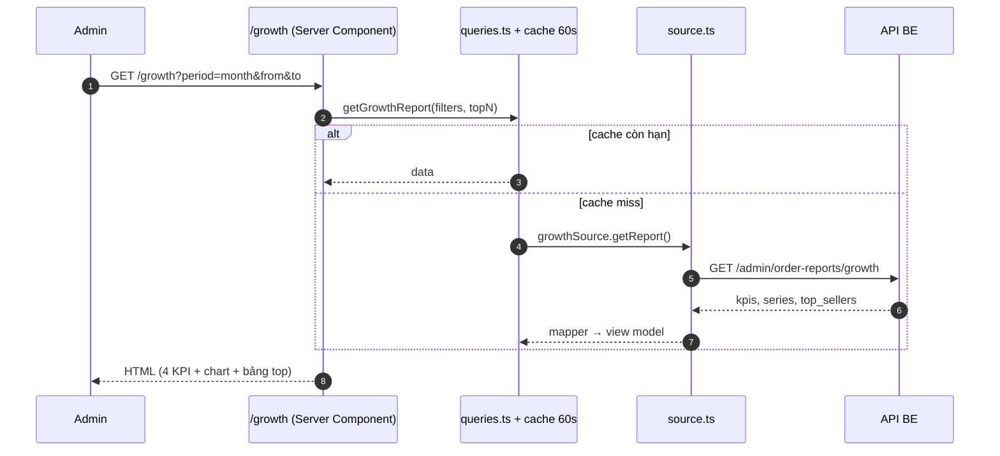
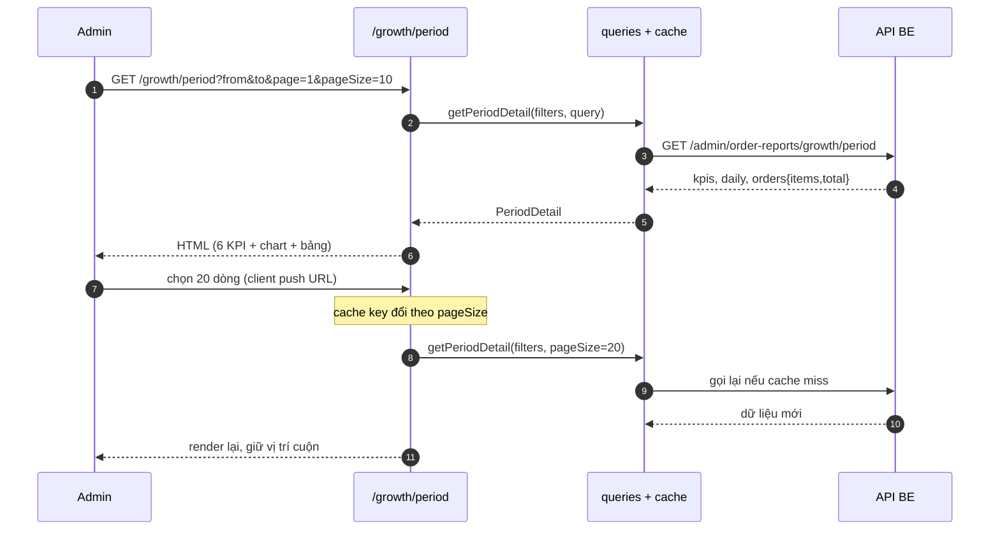
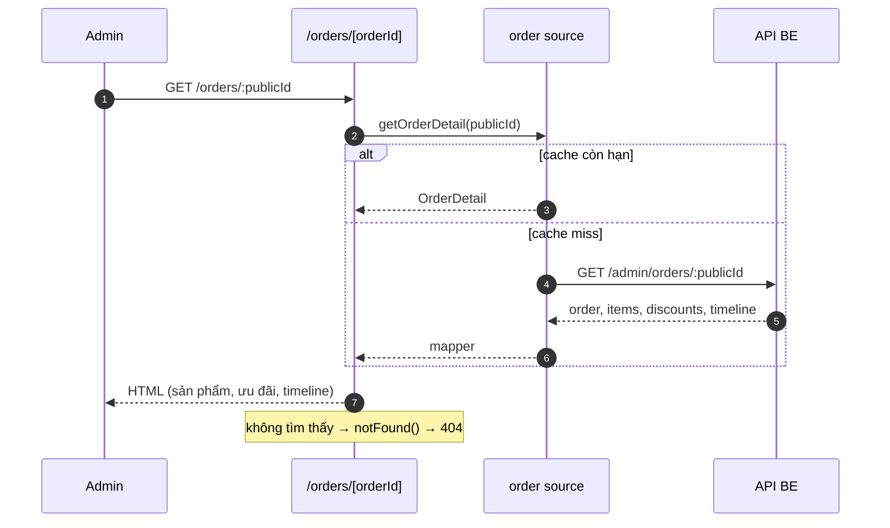

# 0. Bối cảnh và phạm vi

## Đề bài

Anh Thành giao: UI màn hình **báo cáo tăng trưởng** (doanh thu sàn, đơn hàng, user mua hàng) trên Figma; 3 FE và team BE làm theo phân bổ từ kỳ thực tập. Yêu cầu trước khi code:

1. Phân tích, thiết kế tính năng.
2. Xác định các module tương tác.
3. Vẽ flow diagram các API sẽ triển khai.
4. Họp review với anh, chốt xong mới code.

Nguyên tắc anh nhấn mạnh: mục tiêu không phải "làm cho xong việc" mà là **nắm flow, nắm logic, nắm kiến trúc**; bị hỏi bất kỳ điểm nào phải trả lời được ngay, không có "để em check rồi feedback".

## Phân vai

| Vai | Người | Phạm vi |
|---|---|---|
| FE-A | Chinh | M1 Báo cáo tăng trưởng (hub) + platform/UI kit |
| FE-B | Long (báo cáo này) | M2 Chi tiết kỳ · M6 Chi tiết đơn |
| FE-C | Phuc | M4 Chi tiết user · M5 Chi tiết nhà bán |
| BE | team BE | API theo đặc tả M3 trong Figma |
| Review | A Thành | Chốt thiết kế trước khi code |

## Trạng thái code hiện tại

Toàn bộ code trong repo là **prototype do em tự dựng** để kiểm chứng hiểu biết, **không phải deliverable** và không phải kiến trúc đã được anh duyệt. Nếu buổi họp chốt thiết kế khác, em bỏ và làm lại theo design.

Bản báo cáo này trình bày: hiểu biết về đề bài, module tương tác, flow API đề xuất, và những điểm em còn chưa chắc.

# 1. Flow end-to-end

Từ "admin chọn kỳ" ở màn hình M1 đến "bảng đơn hiện 10 dòng" ở M2.

1. Ở M1 `/growth`, bấm một cột trên chart → `GrowthBars` (client component) gọi `router.push('/growth/period?from=<đầu bucket>&to=<cuối bucket>&period=day')`.
2. Next render `app/(admin)/growth/period/page.tsx` — Server Component. `searchParams` là Promise nên phải `await`.
3. `parseFilters(sp)` (zod) → `{from, to, period, tz}`. Mặc định 365 ngày, tối đa 1096 ngày; nếu `from > to` thì ném `FilterError` và rơi vào `growth/error.tsx`.
4. Page đọc riêng `page`, `pageSize` qua `parsePositiveInt` (chặn trần 30), và `q`, `status` trực tiếp từ `searchParams`.
5. `getPeriodDetail(filters, {page, pageSize, q, status})` — bọc `unstable_cache`, `revalidate: 60`, tag `reports:period`. Cache key gồm cả 4 tham số phân trang và tìm kiếm.
6. Cache miss → `periodSource.getDetail` → `pickSource(mock, http)` chọn nguồn theo `DATA_SOURCE`.
7. Mock: `allOrders()` (dataset sinh một lần, cache trong module) → `filterRange` theo `[from, to]` → `totalsOf` cho kỳ này và kỳ trước (`previousRange` lùi đúng độ dài kỳ) → `deltaOf` ra phần trăm.
8. Cùng lúc: `daysBetweenRange` và lọc từng ngày cho `daily`, lấy `peak`; filter theo `q`/`status`; sort `placedAt` giảm dần; `slice` theo `page`.
9. Trả `PeriodDetail { kpis, daily, peak, orders: Page<OrderRow> }`.
10. Page render: header → 3 nút export (chỉ CSV chạy) → `ReportFilter` (form GET) → 6 `KpiCard` → `DailyBars` (CSS bar) → `OrderTable` + form search/trạng thái + `PageSizeSelect` (client) + 2 `Link` phân trang.
11. Tương tác: dropdown page size là client duy nhất (push URL `page=1&pageSize=N`, giữ vị trí cuộn); search và lọc trạng thái đi qua form GET; bấm mã đơn thì sang `/orders/<publicId>`.
12. M6: `getOrderDetail(publicId)` (cache tag `reports:order`) → `orderMockSource.get` tìm theo `publicId` → dựng timeline từ `placedAt/confirmedAt/packedAt/shippedAt/deliveredAt/cancelledAt`. Không thấy thì `notFound()`.

| Bước | Nơi xử lý | Việc xảy ra |
|---|---|---|
| 1 | `GrowthBars` (client) | Push URL kèm `from`/`to` đúng khoảng ngày của bucket |
| 2 | `period/page.tsx` | `await searchParams`, `parseFilters`, `parsePositiveInt` |
| 3 | `queries.ts` | `unstable_cache` 60s, tag `reports:period`, key gồm cả page/q/status |
| 4 | `source.ts` | `pickSource` chọn mock hoặc http theo `DATA_SOURCE` |
| 5 | `period.mock.ts` | Lọc kỳ + kỳ trước, `totalsOf`, `deltaOf`, daily, peak, filter, sort, slice |
| 6 | `page.tsx` | Render 6 KPI, chart, bảng đơn, phân trang |
| 7 | `PageSizeSelect` | Push URL `page=1&pageSize=N`, `scroll: false` |
| 8 | `orders/[orderId]` | `getOrderDetail` → breakdown ưu đãi + timeline |

# 2. Module tương tác

| Module | Loại | State nằm ở | Dữ liệu vào | Sự kiện ra | File |
|---|---|---|---|---|---|
| `ReportFilter` | Server (form GET) | URL (`from`, `to`, `period`) | filter hiện tại | Submit → điều hướng đầy đủ | `platform/ui/report-filter.tsx` |
| `KpiCard` ×6 | Server | — | 1 chỉ số + delta | Không | `platform/ui/kpi-card.tsx` |
| `DailyBars` | Server | — | `daily[]`, `peak` | Không (tooltip bằng `title`) | `features/period-detail/components/daily-bars.tsx` |
| `OrderTable` | Server | — | `OrderRow[]`, `variant` | Link mã đơn → M6 | `platform/ui/order-table.tsx` |
| Form search/trạng thái | Server (form GET) | URL (`q`, `status`) | giá trị hiện tại | Submit → điều hướng | trong `period/page.tsx` |
| `PageSizeSelect` | **Client** | URL (`pageSize`) | `value`, `query`, `basePath` | `router.push` → server render lại | `features/period-detail/components/page-size-select.tsx` |
| Phân trang | Server (`Link`) | URL (`page`) | `page`, `totalPages` | Click → điều hướng | trong `period/page.tsx` |
| Nút export | Server (`a href`) | — | filter hiện tại | Tải file từ route handler | `app/api/exports/period/route.ts` |
| Timeline + breakdown | Server | — | `OrderDetail` | Không | `orders/[orderId]/page.tsx` |

Nguyên tắc chung: **chỉ có một client component** (dropdown); mọi state khác nằm trên URL để share link và back/forward đúng.

# 3. Flow diagram các API

## 3.1 Bảng endpoint FE cần

| Method | Endpoint | Query | Response chính | Màn |
|---|---|---|---|---|
| GET | `/admin/order-reports/growth` | `period`, `dateFrom`, `dateTo`, `topN` | `kpis{orders,gmv,buyers,sellers}`, `series[]`, `top_sellers[]` | M1 |
| GET | `/admin/order-reports/growth/period` | `dateFrom`, `dateTo`, `tab`, `page`, `pageSize`, `q?`, `status?` | `kpis`, `daily[]`, `orders{items,total}` | M2 |
| GET | `/admin/orders/:publicId` | — | `order`, `items[]`, `discounts[]`, `timeline[]` | M6 |
| GET | `/admin/order-reports/growth/customers/:id` | `dateFrom`, `dateTo` | KPI user, chuỗi tháng, top nhà bán, đơn | M4 (Phuc) |
| GET | `/admin/order-reports/growth/sellers/:id` | `dateFrom`, `dateTo`, `bucket` | KPI nhà bán, chuỗi theo mốc, đơn | M5 (Phuc) |

Ba endpoint đầu là phần FE-B phụ thuộc trực tiếp. Cả năm đều là **đề xuất** trong đặc tả M3 của Figma, chưa có trong BE.

## 3.2 Admin mở M1



## 3.3 Admin mở M2 và đổi số dòng mỗi trang



## 3.4 Admin mở chi tiết một đơn (M6)



## 3.5 FE cần BE xác nhận gì

| Vấn đề | Vì sao FE cần biết trước |
|---|---|
| Số tiền là integer VND hay string | Quyết định mapper, tránh sai 1000 lần |
| Timezone của `placed_at` | Nếu BE trả UTC, cắt `slice(0,10)` sẽ lệch ngày |
| `page`/`pageSize` 1-based hay 0-based, mặc định bao nhiêu | Lệch một đơn vị là sai toàn bộ phân trang |
| Sort mặc định của danh sách đơn | FE hiện sort `placedAt` giảm dần, cần khớp BE |
| Mã lỗi và shape lỗi | Để hiển thị đúng `error.tsx` thay vì trắng trang |
| Giới hạn export (số dòng, format) | Quyết định có cần job bất đồng bộ không |

# 4. Bảng hiểu biết

| Khối | Tôi hiểu gì | Chỗ chưa chắc | Cần chốt với ai |
|---|---|---|---|
| Filter kỳ | `parseFilters` chuẩn hoá mọi query, chặn range > 1096 ngày | M2 nhận `period=day` từ chart; nếu range > 92 ngày thì chart theo ngày không đọc được | Mentor (UX) — có nên tự gom theo tuần? |
| 6 KPI | `totalsOf` loại `CANCELLED`; buyers/sellers là distinct; AOV = GMV / số đơn hợp lệ | RMA hoàn một phần chưa bị loại; `NEEDS_RESOLUTION` vẫn tính | BE — điểm cần chốt #2 trong M3 |
| GMV | Mock dùng `order.total` (sau ưu đãi, gồm phí ship) | M3 yêu cầu chốt với báo cáo đối soát: `order_total` hay `sub_total` | BE + kế toán |
| Phân bổ theo ngày | Lặp từng ngày trong kỳ, đếm đơn không huỷ | Đang là O(số ngày × số đơn), chưa gom một lần | Mentor (perf) |
| Bảng đơn | `OrderTable` variant `period`, 13 cột, phân trang server-side | Search không tìm theo mã khách hàng; `q`/`status` không đi qua `parseFilters` | Mentor (scope search) |
| Phân trang | `page`/`pageSize` nằm trên URL, dùng `Link` thuần | Đổi pageSize luôn về trang 1 nên mất vị trí đang xem | Mentor (chấp nhận?) |
| Export | CSV có BOM, các format khác trả 501 | Giới hạn 5.000 dòng và cắt không báo | BE (ngưỡng export) |
| Trang chi tiết đơn | Tìm theo `publicId`, dựng timeline 5 mốc + mốc huỷ | Mock không có mốc "đang giao"; mốc lấy từ cột nào khi BE trả về | BE |
| Breakdown ưu đãi | Mock tạo từng dòng ưu đãi rời nhau | Nếu BE trả cả Thẻ Sành và Giảm giá SP thì có thể cộng trùng | BE — `total_direct_discount` |
| Cache | Một tầng ở `queries.ts`, TTL 60s, tag theo màn | Key gồm cả page/q/status nên nhiều entry; số liệu có thể cũ 60s | Mentor (chấp nhận?) |
| Timezone | Mock ghi `+07:00`, cắt `slice(0,10)` là ra đúng ngày Việt Nam | BE nếu trả UTC thì cắt chuỗi sẽ lệch ngày | BE — điểm cần chốt #3 |

# 5. Prototype hiện tại và lý do chọn

Đây là **lựa chọn cá nhân của em** để kiểm chứng hiểu biết, chưa được duyệt. Em trình bày để anh review chứ không phải để bảo vệ.

```
route (server) → queries (cache) → source (chọn mock|http)
              → mock/http (dữ liệu thô) → mapper (chuẩn hoá) → component (view model)
```

| Lớp | Nếu bỏ thì hỏng gì |
|---|---|
| `page.tsx` | Không có điểm vào; hoặc phải nhét logic vào component client → mất SSR và mất cache |
| `parseFilters` | Mỗi nơi tự đọc `searchParams` → lệch format ngày, lệch default 365 ngày, dễ lọt giá trị rác |
| `queries.ts` | Gọi mock/BE mỗi request; hoặc cache rải rác trong component → hai tầng cache, số lệch nhau |
| `source.ts` | Component import thẳng mock → không đổi được sang BE mà không sửa UI |
| `mapper` | Component nhận snake_case và số dạng string → BE đổi format là vỡ giao diện |
| `component` | Không có gì để hiển thị; nếu fetch trong component thì thành client waterfall |

## Ba quyết định và đánh đổi

1. URL là single source of truth (filter, page, status, q đều trên query). Đánh đổi: mỗi thay đổi là một request, không giữ state tạm; đổi lại share link được, back/forward đúng.
2. Cache một tầng ở `queries.ts`, `fetch` bên trong `no-store`. Đánh đổi: key nở theo tổ hợp tham số, TTL 60s có thể trả số cũ; đổi lại không bao giờ lệch giữa hai tầng cache.
3. `OrderRow` và `OrderTable` đặt ở vùng dùng chung vì ba màn M2/M4/M5 cần cùng bộ cột. Đánh đổi: muốn cột riêng cho M2 phải thêm `variant` hoặc mở PR cho FE-A.

# 6. Hai mươi lăm câu hỏi "why"

1. Vì sao User mua hàng không cộng dồn từ ngày lên tháng? Vì đó là `COUNT(DISTINCT customer_id)`; một người mua ba ngày vẫn là một user.
2. Kỳ đang diễn ra tính thế nào? Hiện mock tính số thực tế của những ngày đã qua; M3 đề xuất dự phóng theo số ngày đã qua nhưng chưa làm.
3. Đổi pageSize sao lại về trang 1? Vì tổng số trang giảm, đang ở trang 9 mà chọn 30 dòng/trang sẽ ra trang trống.
4. Cache nằm ở đâu, TTL bao lâu? Ở `queries.ts`, `unstable_cache`, 60 giây, tag `reports:period`.
5. Vì sao `fetch` bên trong lại `no-store`? Để chỉ có một tầng cache; cache hai tầng dễ trả số lệch nhau.
6. Đổi filter có gọi lại dữ liệu không? Có, cache key đổi theo `from/to/period/page/q/status` nên là entry khác.
7. Hai người cùng filter thì sao? Dùng chung một cache entry, request thứ hai không tính lại.
8. BE trả số dạng string thì xử lý ở đâu? Ở mapper (`toInt`); component chỉ nhận `number`.
9. Sao `daily` không gom một lần mà lọc từng ngày? Đúng, đây là điểm chưa tối ưu: O(số ngày × số đơn) mỗi lần render.
10. "Cao nhất ngày X" tính trên ngày nào? Trên mọi ngày trong kỳ, kể cả ngày 0 đơn.
11. Search tìm theo trường nào? `publicId`, `sellerName`, `customerName`; không tìm theo mã khách hàng.
12. Search có phân biệt hoa thường? Không, cả hai phía đều `toLowerCase()`.
13. Chọn "Tất cả trạng thái" xử lý ra sao? Giá trị `ALL` được coi như không lọc.
14. Tổng đơn có tính đơn huỷ không? Không, `totalsOf` loại `CANCELLED`; nhưng danh sách vẫn hiện đơn huỷ nếu không lọc.
15. Bảng chỉ 10 dòng mà tổng 1.526 thì sao? Phân trang server-side: mock `slice(start, start + pageSize)` sau khi lọc và sort.
16. AOV tính thế nào? `GMV / số đơn hợp lệ`, đã loại đơn huỷ, làm tròn.
17. Tỷ lệ khách mới tính thế nào? Khách có đơn đầu tiên (toàn lịch sử) nằm trong kỳ, chia cho số buyer của kỳ.
18. Kỳ trước lấy thế nào? `previousRange` lùi đúng độ dài kỳ, không phải "tháng trước".
19. Sao dropdown phải `'use client'`? Vì dùng `onChange` và `router`; function không truyền được qua ranh giới server → client.
20. Sao XLSX/PDF trả 501? Chưa chọn thư viện; hiện chỉ CSV có BOM để Excel không vỡ dấu.
21. Export có giới hạn không? 5.000 dòng và hiện cắt im lặng, chưa cảnh báo người dùng.
22. M6 tìm đơn theo gì? Theo `publicId` (mã hiển thị), không phải `id` nội bộ.
23. Timeline lấy mốc từ đâu? Các cột thời điểm trên order: placed, confirmed, packed, shipped, delivered, cancelled.
24. Không tìm thấy đơn thì sao? `notFound()` → trang 404 của Next.
25. Sao không cộng Thẻ Sành thành một dòng riêng? Vì nó đã nằm trong `total_product_discount`; cộng thêm là trùng.

# 7. Kịch bản demo ba phút

| Bước | Bấm gì | Câu chốt |
|---|---|---|
| 1 | `/growth`, chọn kỳ tháng | Filter nằm trên URL, server render lại theo query |
| 2 | Bấm một cột trên chart | Cột là một bucket; click truyền đúng khoảng ngày của bucket sang M2 |
| 3 | Ở M2, chỉ vào 6 KPI | Kỳ này và kỳ trước tính bằng cùng một hàm, chênh lệch ra phần trăm |
| 4 | Cuộn xuống bảng, gõ tìm kiếm | Tìm theo mã đơn/nhà bán/khách; lọc và phân trang đều ở server |
| 5 | Đổi dropdown 20 dòng | Đây là client component duy nhất trên trang, chỉ để điều hướng URL |
| 6 | Bấm mã đơn | M6 nhận publicId, không phải id nội bộ |
| 7 | Chỉ vào breakdown ưu đãi | Thẻ Sành đã nằm trong giảm giá sản phẩm, không cộng lần hai |

Chỗ dễ bị hỏi chen ngang: bước 4 (sao không dùng client filter) và bước 7 (công thức ưu đãi).

# 8. Năm điểm dễ bị bắt bí

| # | Điểm yếu | Cách trả lời trung thực |
|---|---|---|
| 1 | `daily` chưa tối ưu, O(days × orders) | Đúng, đang lọc từng ngày; hướng sửa là gom một lần bằng Map rồi map ra bucket |
| 2 | Chưa có dự phóng cho kỳ đang diễn ra | M3 có đề xuất công thức; em chưa làm vì chờ chốt cách tính ngày đã qua |
| 3 | Export cắt 5.000 dòng im lặng | Đây là lỗi UX; nên trả 400 hoặc chuyển sang job bất đồng bộ |
| 4 | Cache 60s có thể trả số cũ | Chấp nhận cho báo cáo; nếu cần tức thời thì BE gọi webhook revalidate theo tag |
| 5 | Tỷ lệ khách mới phụ thuộc lịch sử toàn bộ | Với mock em quét cả dataset; với BE phải có cột ngày mua đầu hoặc query MIN, chưa chốt |

# 9. Hai câu mở đầu buổi họp

Figma là đề bài anh giao. Repo hiện tại là prototype em tự dựng để kiểm chứng hiểu biết, không phải sản phẩm để nộp; nếu anh chốt thiết kế khác thì em bỏ và làm lại theo đúng design.

Phần em chưa chắc em ghi rõ ở mục 4. Em muốn chốt ba điểm: GMV dùng `order_total` hay `sub_total`, đơn `NEEDS_RESOLUTION` có tính vào số đơn không, và timezone khi cắt ngày.
