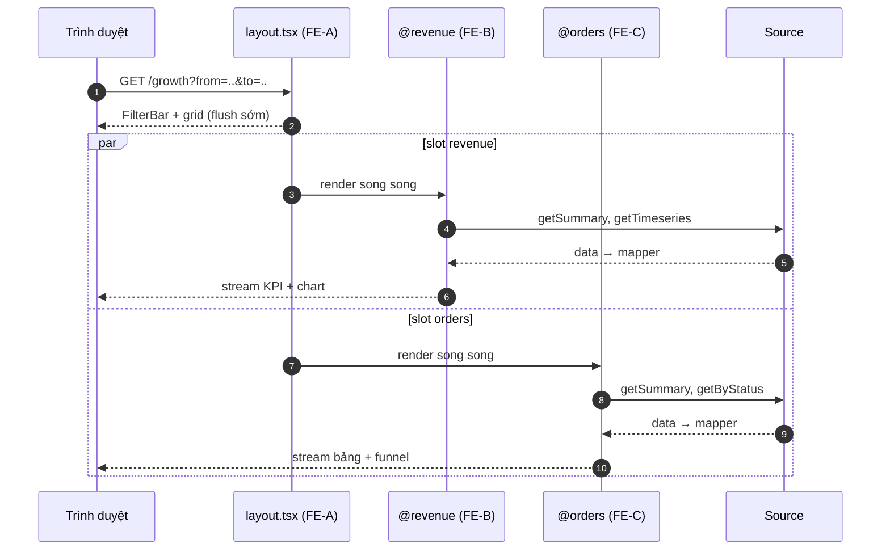
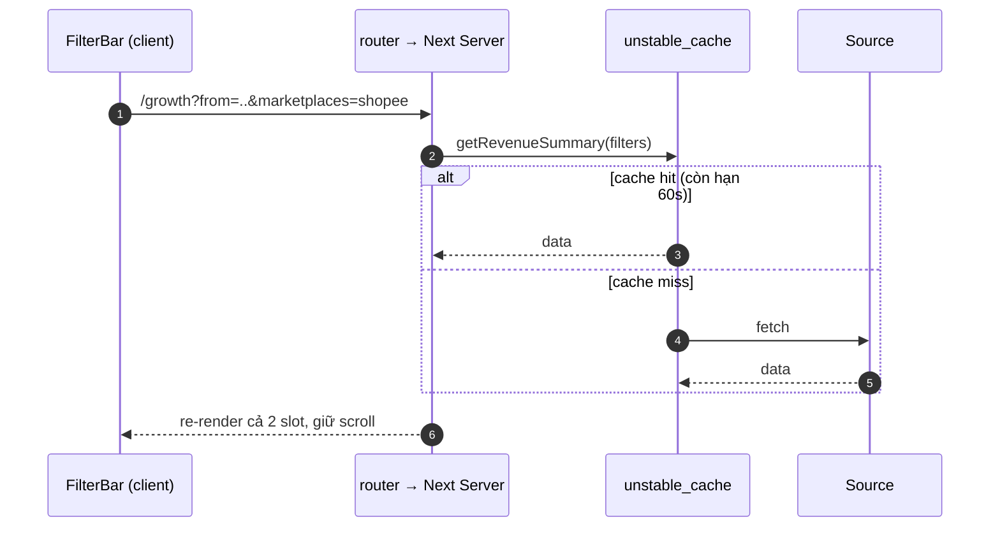
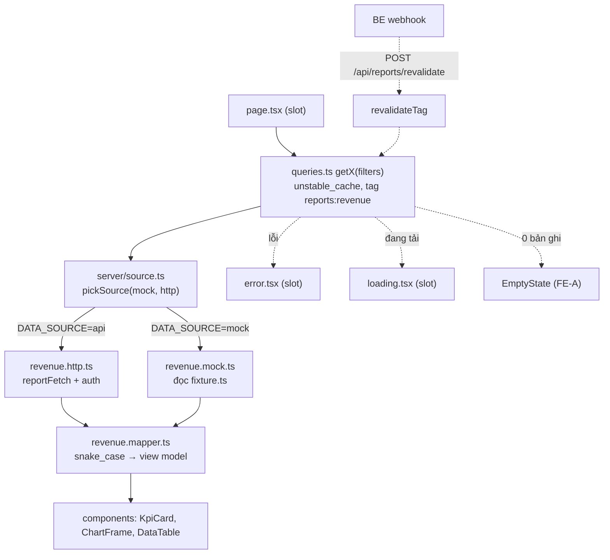

# 1. Tóm tắt điều hành

## 1.1 Mục tiêu

Xây dựng màn hình **Báo cáo tăng trưởng** (GMV sàn, đơn hàng, user mua hàng) cho 3 FE làm song song trên cùng một repo, mỗi người sở hữu một slice độc lập, merge không conflict, và có sẵn điểm cắm để nối API thật khi BE bàn giao.

## 1.2 Phạm vi

| Hạng mục | Nội dung |
|---|---|
| Trong phạm vi | 1 trang `/growth`, filter theo kỳ + sàn + granularity + kỳ so sánh, 4 KPI, 3 chart, 3 bảng, export CSV |
| Ngoài phạm vi | Phân quyền chi tiết, realtime, so sánh nhiều kỳ cùng lúc, mobile layout dưới 768px |
| Stack cố định | Next.js 15 App Router, TypeScript strict, Tailwind, shadcn/ui, Recharts, zod |
| Team | 3 FE, chưa có BE (BE bàn giao API sau) |

## 1.3 Ba quyết định kiến trúc chính

| # | Quyết định | Lý do |
|---|---|---|
| 1 | Dùng **Parallel Routes** (`@revenue`, `@orders`) làm ranh giới sở hữu | Mỗi slot là một folder riêng, có `loading.tsx` và `error.tsx` riêng, stream độc lập. Chỉ FE-A viết `layout.tsx` một lần, B/C không bao giờ phải sửa file chung |
| 2 | Dữ liệu đi qua **Server Component → source layer → mapper**, không fetch trong component | Component chỉ biết view model. Đổi nguồn mock sang API thật là đổi đúng một chỗ, UI không đổi một dòng |
| 3 | **Một owner cho một file**, chặn bằng CODEOWNERS + ESLint boundaries | Conflict bị chặn ở CI thay vì phát hiện lúc review hoặc lúc merge |

## 1.4 Điều cần chốt trong buổi review

1. Bảng phân rã block ở Mục 2 có khớp với frame Figma chưa (đang là giả định).
2. FE-A là critical path: chấp nhận merge `layout.tsx` + contract xong trong ngày 1–2.
3. Chốt 8 câu hỏi cho BE ở Mục 10.1 trước khi bắt đầu code.
4. Cohort retention để phase 2 nếu C quá tải.

# 2. Phân rã UI theo slice

Danh sách block dưới đây là **giả định** dựa trên mô tả phạm vi, cần đối chiếu lại với frame export từ Figma trước khi khoá. Cột Est theo thang S / M / L.

| # | Block | Loại | Dữ liệu chính | Owner | File sở hữu | Est |
|---|---|---|---|---|---|---|
| 1 | FilterBar (kỳ, granularity, sàn, so sánh) | filter | `from, to, granularity, marketplaces, compare` | FE-A | `app/(growth)/growth/_components/filter-bar*.tsx` | M |
| 2 | Nút Export CSV | action | kế thừa filter | FE-A | `_components/export-button.tsx` | S |
| 3 | KPI GMV + % tăng trưởng | KPI | `gmv, delta` | FE-B | `@revenue/page.tsx` | S |
| 4 | KPI Đơn hàng + AOV | KPI | `orders, aov, delta` | FE-C | `@orders/page.tsx` | S |
| 5 | Growth chart (GMV / orders / buyers) | chart | `TimeseriesPoint[]` | FE-B | `features/revenue/components/growth-chart.tsx` | M |
| 6 | Doanh thu theo sàn | chart + table | `MarketplaceRevenue[]` | FE-B | `components/marketplace-breakdown.tsx` | M |
| 7 | Funnel trạng thái đơn | chart | `OrderStatusBucket[]` | FE-C | `features/orders/components/status-funnel.tsx` | M |
| 8 | New vs returning | donut | `BuyerMix` | FE-C | `features/buyers/components/buyer-mix.tsx` | S |
| 9 | Cohort retention | table | `CohortRow[]` | FE-C | `components/cohort-table.tsx` | L |
| 10 | Top buyers | table | `TopBuyer[]` | FE-C | `components/top-buyers-table.tsx` | M |
| 11 | Empty / Error / Skeleton | state | — | FE-A | `src/platform/ui/*-state.tsx` | S |

## 2.1 Cân bằng tải

- **FE-A** nặng ở giai đoạn đầu vì là critical path (shell, contract, UI kit, data layer), nhẹ dần về cuối.
- **FE-B** và **FE-C** tương đương nhau. C nhỉnh hơn vì cohort table và 2 bảng.
- Nếu C quá tải: cắt block 9 (cohort) xuống phase 2, hoặc chuyển block 8 sang B. Phải chốt **trước** khi code, không đổi giữa sprint.

## 2.2 Quy tắc ranh giới

1. Mỗi file/folder chỉ có đúng một owner. Không tồn tại file mà hai người cùng sửa.
2. B/C chỉ đặt component vào slot của mình, không sửa `layout.tsx`, không sửa `src/platform/**`.
3. Export CSV tách route handler riêng theo slice, không làm route export dùng chung.
4. Mọi dependency mới vào `package.json` phải qua PR riêng do FE-A merge.

# 3. Hợp đồng dữ liệu và API

## 3.1 Bảng endpoint

Owner là người viết route handler export và fixture; contract thì cả ba cùng review.

| Method | Path | Query | Response | Owner | Fixture |
|---|---|---|---|---|---|
| GET | `/v1/reports/meta/marketplaces` | — | `Marketplace[]` | A | `platform/reports/fixtures/marketplaces.ts` |
| GET | `/v1/reports/revenue/summary` | filters | `RevenueSummary` | B | `features/revenue/server/fixture.ts` |
| GET | `/v1/reports/revenue/timeseries` | filters | `TimeseriesPoint[]` | B | nt |
| GET | `/v1/reports/revenue/by-marketplace` | filters | `MarketplaceRevenue[]` | B | nt |
| GET | `/v1/reports/orders/summary` | filters | `OrderSummary` | C | `features/orders/server/fixture.ts` |
| GET | `/v1/reports/orders/timeseries` | filters | `TimeseriesPoint[]` | C | nt |
| GET | `/v1/reports/orders/by-status` | filters | `OrderStatusBucket[]` | C | nt |
| GET | `/v1/reports/buyers/summary` | filters | `BuyerSummary` | C | `features/buyers/server/fixture.ts` |
| GET | `/v1/reports/buyers/cohort` | filters + `cohortUnit` | `CohortRow[]` | C | nt |
| GET | `/v1/reports/buyers/top` | filters + `limit` | `TopBuyer[]` | C | nt |

## 3.2 Type nền

Ring 0 — FE-A sở hữu, chỉ được thêm, không đổi tên field.

```ts
// src/contracts/base.ts
export type IsoDate = string; // 'YYYY-MM-DD'
export type Currency = 'VND';

/** Số tiền luôn là số nguyên đơn vị nhỏ nhất (VND = đồng). Cấm string ở tầng view. */
export type Money = { amount: number; currency: Currency };

export type DateRange = { from: IsoDate; to: IsoDate };

export type Delta = {
  value: number;              // chênh tuyệt đối so với kỳ so sánh
  pct: number | null;         // null khi kỳ trước = 0 (không chia được)
  direction: 'up' | 'down' | 'flat';
  compareTo: DateRange | null;
};

export type Percent = number;  // 0..1
export type Paginated<T> = { items: T[]; total: number; page: number; pageSize: number };
export type Granularity = 'day' | 'week' | 'month';
export type CompareMode = 'previous_period' | 'previous_year' | 'none';
export type Marketplace = { id: string; name: string; logoUrl?: string };
```

## 3.3 Contract từng slice

```ts
// src/features/revenue/contracts.ts — FE-B
import type { Money, Delta, DateRange, Marketplace } from '@/contracts/base';

export type RevenueSummary = {
  range: DateRange;
  gmv: Money;
  gmvDelta: Delta;
  orderCount: number;
  orderCountDelta: Delta;
  gmvPerDay: Money;
  growthRate: number | null;   // null khi kỳ < 2 ngày
};

export type TimeseriesPoint = {
  bucket: string;              // '2026-11-01' | '2026-W44' | '2026-11'
  gmv: number;                 // VND, integer
  orders: number;
  buyers: number;
  gmvPrev?: number | null;     // kỳ so sánh, cùng độ dài
};

export type MarketplaceRevenue = {
  marketplace: Marketplace;
  gmv: Money;
  share: number;               // 0..1
  delta: Delta;
};

/** HỢP ĐỒNG VỚI BE — không đổi signature, chỉ thêm method */
export interface RevenueSource {
  getSummary(f: ReportFilters): Promise<RevenueSummary>;
  getTimeseries(f: ReportFilters): Promise<TimeseriesPoint[]>;
  getByMarketplace(f: ReportFilters): Promise<MarketplaceRevenue[]>;
}
```

```ts
// src/features/orders/contracts.ts — FE-C
export type OrderSummary = {
  orders: number;
  ordersDelta: Delta;
  aov: Money;
  aovDelta: Delta;
  cancelRate: number;    // 0..1
  returnRate: number;    // 0..1
};

export type OrderStatusBucket = {
  status: 'pending' | 'confirmed' | 'shipping' | 'delivered' | 'cancelled' | 'returned';
  count: number;
  gmv: Money;
};

export interface OrderSource {
  getSummary(f: ReportFilters): Promise<OrderSummary>;
  getTimeseries(f: ReportFilters): Promise<TimeseriesPoint[]>;
  getByStatus(f: ReportFilters): Promise<OrderStatusBucket[]>;
}
```

```ts
// src/features/buyers/contracts.ts — FE-C
export type BuyerSummary = {
  totalBuyers: number;
  buyersDelta: Delta;
  newBuyers: number;
  returningBuyers: number;
  newRatio: number;        // 0..1
  repeatRate: number;      // 0..1
  arpu: Money;
};

export type CohortRow = {
  cohort: string;                      // '2026-10'
  cohortSize: number;
  retention: Array<number | null>;     // m[0] = kỳ đầu; null = chưa đủ dữ liệu
};

export type TopBuyer = {
  userId: string;
  displayName: string;
  orders: number;
  gmv: Money;
  lastOrderAt: string;     // ISO
};

export interface BuyerSource {
  getSummary(f: ReportFilters): Promise<BuyerSummary>;
  getCohort(f: ReportFilters): Promise<CohortRow[]>;
  getTop(f: ReportFilters, limit: number): Promise<TopBuyer[]>;
}
```

## 3.4 Hợp đồng filter

`parseFilters()` là entry point duy nhất. Cấm page/route handler tự đọc `searchParams`.

```ts
// src/platform/reports/filters.ts — FE-A
import { z } from 'zod';
import type { CompareMode, Granularity } from '@/contracts/base';

export const GRANULARITIES = ['day', 'week', 'month'] as const satisfies readonly Granularity[];
export const COMPARE_MODES = ['previous_period', 'previous_year', 'none'] as const satisfies readonly CompareMode[];

export type SearchParamsInput = Record<string, string | string[] | undefined>;

export type ReportFilters = {
  from: string; to: string;
  granularity: Granularity; compare: CompareMode;
  marketplaces: string[]; tz: string;
};

const MAX_RANGE_DAYS = 366;
const DEFAULT_RANGE_DAYS = 30;
const isoDate = z.string().regex(/^\d{4}-\d{2}-\d{2}$/, 'định dạng YYYY-MM-DD');

const schema = z.object({
  from: isoDate.optional(),
  to: isoDate.optional(),
  granularity: z.enum(GRANULARITIES).catch('day'),
  compare: z.enum(COMPARE_MODES).catch('previous_period'),
  marketplaces: z.union([z.string(), z.array(z.string())]).optional(),
  tz: z.string().min(1).default('Asia/Ho_Chi_Minh'),
});

const pad = (n: number) => String(n).padStart(2, '0');

function todayIn(tz: string): string {
  return new Intl.DateTimeFormat('en-CA', { timeZone: tz }).format(new Date());
}

function shiftDays(iso: string, days: number): string {
  const [y, m, d] = iso.split('-').map(Number);
  const t = new Date(Date.UTC(y, m - 1, d));
  t.setUTCDate(t.getUTCDate() + days);
  return `${t.getUTCFullYear()}-${pad(t.getUTCMonth() + 1)}-${pad(t.getUTCDate())}`;
}

function daysBetween(a: string, b: string): number {
  const ms = (s: string) => { const [y, m, d] = s.split('-').map(Number); return Date.UTC(y, m - 1, d); };
  return Math.round((ms(b) - ms(a)) / 86_400_000) + 1;
}

function normalizeList(v: string | string[] | undefined): string[] {
  if (!v) return [];
  const arr = Array.isArray(v) ? v : v.split(',');
  return [...new Set(arr.map((s) => s.trim()).filter(Boolean))];
}

export class FilterError extends Error {}

/** Entry point DUY NHẤT cho mọi page / route handler. */
export function parseFilters(input: SearchParamsInput): ReportFilters {
  const p = schema.parse(input ?? {});
  const to = p.to ?? todayIn(p.tz);
  const from = p.from ?? shiftDays(to, -(DEFAULT_RANGE_DAYS - 1));

  if (from > to) throw new FilterError('from phải <= to');
  if (daysBetween(from, to) > MAX_RANGE_DAYS) throw new FilterError(`tối đa ${MAX_RANGE_DAYS} ngày`);

  return { ...p, from, to, marketplaces: normalizeList(p.marketplaces) };
}

/** FilterBar dùng để build URL; export route dùng để build query sang BE */
export function filtersToQueryString(f: ReportFilters): string {
  const q = new URLSearchParams({
    from: f.from, to: f.to, granularity: f.granularity, compare: f.compare, tz: f.tz,
  });
  for (const m of f.marketplaces) q.append('marketplaces', m);
  return q.toString();
}

/** Key cache ổn định — đổi thứ tự filter không làm hỏng cache */
export function filtersCacheKey(f: ReportFilters): string {
  return JSON.stringify({ ...f, marketplaces: [...f.marketplaces].sort() });
}
```

## 3.5 Quy tắc thay đổi contract

| Được phép | Bị cấm |
|---|---|
| Thêm field optional (không ảnh hưởng code cũ) | Đổi tên field, đổi kiểu, đổi đơn vị |
| Thêm method vào interface với impl mặc định | Xoá method, đổi chữ ký |
| Thêm variant cho UI kit | Fork component của người khác |

Mọi thay đổi contract phải là PR riêng, hai người review, và ghi vào mục Contract impact của PR template.

# 4. Sơ đồ luồng

## 4.1 Load trang

Hai slot fetch song song, stream độc lập, lỗi cô lập theo slot.



## 4.2 Đổi filter

URL là single source of truth. Không có state filter nào nằm trong React store.



Ghi chú triển khai cho FE-A: debounce 300ms trước khi `router.replace`, bọc trong `useTransition()` để không block UI, và giữ `scroll: false` để trang không nhảy lên đầu.

## 4.3 Đường đi dữ liệu và điểm cắm BE



## 4.4 Cache và revalidate

| Tầng | Cấu hình | Ghi chú |
|---|---|---|
| `fetch` trong `*.http.ts` | `cache: 'no-store'` | Tránh cache hai tầng, gây số liệu lệch |
| Getter trong `queries.ts` | `unstable_cache`, `revalidate: 60`, `tags: [REPORT_TAGS.<slice>]` | Tầng cache duy nhất |
| Meta (danh sách sàn) | `revalidate: 3600` | Ít thay đổi |
| BE đẩy số mới | `POST /api/reports/revalidate` với header `x-revalidate-secret` | Tag validate bằng regex `^reports:[a-z-]+$` để thêm slice mới không phải sửa file |

Next.js 15 mặc định **không cache** `fetch`, nên không được dựa vào `next.revalidate` rải rác trong component — toàn bộ caching nằm ở `queries.ts`.

# 5. Cấu trúc thư mục

## 5.1 Cây thư mục

```
app/
├─ (growth)/growth/
│  ├─ layout.tsx                    FE-A  grid + FilterBar + props {revenue, orders}
│  ├─ page.tsx                      FE-A  return null, chỉ để route hợp lệ
│  ├─ error.tsx                     FE-A  lỗi toàn shell
│  ├─ _components/
│  │  ├─ filter-bar.tsx             FE-A  server, đọc filters
│  │  ├─ filter-bar.client.tsx      FE-A  'use client', router.replace
│  │  ├─ report-grid.tsx            FE-A  grid-area definitions
│  │  └─ export-button.tsx          FE-A  generic, nhận href
│  ├─ @revenue/
│  │  ├─ page.tsx                   FE-B
│  │  ├─ loading.tsx                FE-B
│  │  ├─ error.tsx                  FE-B
│  │  └─ default.tsx                FE-B  chống 404 khi hard nav
│  └─ @orders/
│     ├─ page.tsx                   FE-C
│     ├─ loading.tsx                FE-C
│     ├─ error.tsx                  FE-C
│     └─ default.tsx                FE-C
└─ api/reports/
   ├─ revalidate/route.ts           FE-A
   ├─ revenue/export/route.ts       FE-B
   ├─ orders/export/route.ts        FE-C
   └─ buyers/export/route.ts        FE-C

src/
├─ contracts/base.ts                FE-A  ring 0, additive-only
├─ platform/                        FE-A  toàn bộ
│  ├─ reports/
│  │  ├─ filters.ts
│  │  ├─ source.ts                  pickSource
│  │  ├─ tags.ts                    REPORT_TAGS
│  │  ├─ http.ts                    reportFetch, auth, timeout
│  │  ├─ csv.ts                     toCsv + BOM UTF-8
│  │  └─ fixtures/marketplaces.ts
│  ├─ ui/                           kpi-card, chart-frame, data-table,
│  │                                empty-state, error-state, delta-badge, skeleton
│  ├─ format/                       money.ts, percent.ts, date.ts
│  └─ styles/tokens.css
└─ features/
   ├─ revenue/                      FE-B
   │  ├─ contracts.ts
   │  ├─ server/                    source.ts, revenue.mock.ts, revenue.http.ts,
   │  │                             revenue.mapper.ts, fixture.ts, queries.ts
   │  ├─ components/                growth-chart, marketplace-breakdown, revenue-kpis
   │  └─ __tests__/                 mapper.test.ts, contract.test.ts
   ├─ orders/                       FE-C  cùng cấu trúc
   └─ buyers/                       FE-C  cùng cấu trúc
```

## 5.2 Ranh giới sở hữu

| Vùng | Owner | Người khác được làm gì |
|---|---|---|
| `app/(growth)/growth/layout.tsx`, `_components/**` | FE-A | Chỉ đọc, muốn đổi thì mở PR 3 dòng |
| `src/platform/**`, `src/contracts/**` | FE-A | Chỉ import, không sửa |
| `app/.../@revenue/**`, `src/features/revenue/**` | FE-B | Không ai khác chạm |
| `app/.../@orders/**`, `src/features/orders/**`, `src/features/buyers/**` | FE-C | Không ai khác chạm |

# 6. Điểm cắm dữ liệu BE

## 6.1 Cơ chế

Khi BE bàn giao, chỉ cần sửa **hai file + một biến môi trường** cho mỗi slice:

| Bước | File | Việc làm |
|---|---|---|
| 1 | `src/features/<slice>/server/<x>.http.ts` | Implement interface `<X>Source` bằng `reportFetch` |
| 2 | `src/features/<slice>/server/<x>.mapper.ts` | Map response thô (snake_case, số dạng string) sang view model |
| 3 | `.env` | `DATA_SOURCE=api`, `REPORT_API_BASE_URL=...`, `REPORT_API_TOKEN=...` |

Page, component, hook, chart không đổi một dòng. Không ai phải sửa file dùng chung, nên ba người vẫn merge độc lập.

## 6.2 Code

```ts
// src/platform/reports/source.ts — FE-A
import 'server-only';

/**
 * Điểm chuyển nguồn DUY NHẤT (per-slice).
 * Mỗi feature tự gọi pickSource(mock, http) trong server/source.ts của mình
 * → platform không import features, không ai phải sửa file chung khi BE bàn giao.
 */
export function pickSource<M extends object, A extends object>(mock: M, api: A): M | A {
  return process.env.DATA_SOURCE === 'api' ? api : mock;
}
```

```ts
// src/platform/reports/tags.ts — FE-A, additive-only
export const REPORT_TAGS = {
  revenue: 'reports:revenue',
  orders: 'reports:orders',
  buyers: 'reports:buyers',
  meta: 'reports:meta',
} as const;
export type ReportTag = (typeof REPORT_TAGS)[keyof typeof REPORT_TAGS];
```

```ts
// src/platform/reports/http.ts — FE-A, mọi *.http.ts dùng lại
import 'server-only';

export class ReportApiError extends Error {
  constructor(readonly path: string, readonly status: number, readonly body: string) {
    super(`Report API ${status} @ ${path}`);
  }
}

export type Query = Record<string, string | number | boolean | string[] | undefined | null>;

export async function reportFetch<T>(path: string, query: Query = {}): Promise<T> {
  const base = process.env.REPORT_API_BASE_URL;
  if (!base) throw new Error('Thiếu REPORT_API_BASE_URL khi DATA_SOURCE=api');

  const url = new URL(path, base);
  for (const [k, v] of Object.entries(query)) {
    if (v == null || v === '') continue;
    if (Array.isArray(v)) v.forEach((item) => url.searchParams.append(k, item));
    else url.searchParams.set(k, String(v));
  }

  const res = await fetch(url, {
    cache: 'no-store',              // caching do unstable_cache lo
    headers: {
      accept: 'application/json',
      authorization: `Bearer ${process.env.REPORT_API_TOKEN ?? ''}`,
      'x-request-id': crypto.randomUUID(),
    },
    signal: AbortSignal.timeout(8_000),
  });

  if (!res.ok) throw new ReportApiError(path, res.status, await res.text().catch(() => ''));
  return (await res.json()) as T;
}
```

```ts
// src/features/revenue/server/source.ts — FE-B (orders/buyers copy y hệt)
import 'server-only';
import { pickSource } from '@/platform/reports/source';
import type { RevenueSource } from '../contracts';
import { revenueMockSource } from './revenue.mock';
import { revenueHttpSource } from './revenue.http';

export const revenueSource: RevenueSource = pickSource(revenueMockSource, revenueHttpSource);
```

```ts
// src/features/revenue/server/queries.ts — FE-B
import 'server-only';
import { unstable_cache } from 'next/cache';
import { REPORT_TAGS } from '@/platform/reports/tags';
import type { ReportFilters } from '@/platform/reports/filters';
import { revenueSource } from './source';

export const getRevenueSummary = unstable_cache(
  (f: ReportFilters) => revenueSource.getSummary(f),
  ['revenue:summary'],
  { revalidate: 60, tags: [REPORT_TAGS.revenue] },
);
```

```ts
// src/features/revenue/server/revenue.http.ts — FILE DUY NHẤT viết khi BE xong
import 'server-only';
import { reportFetch } from '@/platform/reports/http';
import { filtersToQueryString } from '@/platform/reports/filters';
import type { RevenueSource } from '../contracts';
import { mapSummary, mapTimeseries, mapMarketplace } from './revenue.mapper';

/** Response thô của BE — snake_case, số dạng string. Không export ra ngoài file này. */
type RawSummary = { gmv: string; order_count: number; gmv_per_day: string; growth_rate: number | null };
type RawPoint = { bucket: string; gmv: string; orders: number; buyers: number; gmv_prev: string | null };
type RawMarketplace = { id: string; name: string; gmv: string; share: number };

const q = (f: ReportFilters) => Object.fromEntries(new URLSearchParams(filtersToQueryString(f)));

export const revenueHttpSource: RevenueSource = {
  async getSummary(f) {
    return mapSummary(await reportFetch<RawSummary>('/v1/reports/revenue/summary', q(f)));
  },
  async getTimeseries(f) {
    return (await reportFetch<RawPoint[]>('/v1/reports/revenue/timeseries', q(f))).map(mapTimeseries);
  },
  async getByMarketplace(f) {
    return (await reportFetch<RawMarketplace[]>('/v1/reports/revenue/by-marketplace', q(f))).map(mapMarketplace);
  },
};
```

## 6.3 Checklist bàn giao BE

1. BE gửi OpenAPI spec hoặc ít nhất một sample response thật cho mỗi endpoint.
2. FE đối chiếu sample với type trong `contracts.ts`; nếu lệch, sửa contract bằng PR riêng.
3. Viết `<x>.http.ts` implement `<X>Source`.
4. Viết `<x>.mapper.ts`, thêm test cho mapper với sample thật đó.
5. Đổi `DATA_SOURCE=api` trên môi trường staging, chạy lại test contract.
6. So sánh màn hình staging với bản mock, xác nhận không khác biệt về layout.
7. Xoá `revenue.mock.ts` khỏi bundle (hoặc giữ cho Storybook) và cập nhật README của slice.

# 7. Quy trình GitHub

## 7.1 Branch và thứ tự merge

| Branch | Owner | Merge |
|---|---|---|
| `feat/fe-a-shell` | FE-A | Trước tiên, ngày 1–2 |
| `feat/fe-b-revenue` | FE-B | Sau khi A merge, rebase lên main |
| `feat/fe-c-orders` | FE-C | Sau khi A merge, rebase lên main |

Quy ước commit: conventional commits (`feat(revenue): add growth chart`). PR ≤ 400 dòng diff, không tính fixture và test.

## 7.2 CODEOWNERS

```
/app/(growth)/growth/layout.tsx      @fe-a
/app/(growth)/growth/page.tsx        @fe-a
/app/(growth)/growth/error.tsx       @fe-a
/app/(growth)/growth/_components/    @fe-a
/app/api/reports/revalidate/         @fe-a
/src/platform/                       @fe-a
/src/contracts/                      @fe-a

/app/(growth)/growth/@revenue/       @fe-b
/app/api/reports/revenue/export/     @fe-b
/src/features/revenue/               @fe-b

/app/(growth)/growth/@orders/        @fe-c
/app/api/reports/orders/export/      @fe-c
/app/api/reports/buyers/export/      @fe-c
/src/features/orders/                @fe-c
/src/features/buyers/                @fe-c
```

## 7.3 ESLint boundaries

Chặn import chéo ở CI, không chờ review bằng mắt.

```js
// eslint.config.mjs
import boundaries from 'eslint-plugin-boundaries';

export default [
  {
    plugins: { boundaries },
    settings: {
      'boundaries/include': ['src/**/*', 'app/**/*'],
      'boundaries/elements': [
        { type: 'contracts', pattern: 'src/contracts/**' },
        { type: 'platform', pattern: 'src/platform/**' },
        { type: 'feat-revenue', pattern: 'src/features/revenue/**' },
        { type: 'feat-orders', pattern: 'src/features/orders/**' },
        { type: 'feat-buyers', pattern: 'src/features/buyers/**' },
        { type: 'app', pattern: 'app/**' },
      ],
    },
    rules: {
      'boundaries/element-types': ['error', {
        default: 'disallow',
        rules: [
          { from: 'contracts', allow: [] },
          { from: 'platform', allow: ['contracts'] },
          { from: 'feat-revenue', allow: ['contracts', 'platform', 'feat-revenue'] },
          { from: 'feat-orders', allow: ['contracts', 'platform', 'feat-orders'] },
          { from: 'feat-buyers', allow: ['contracts', 'platform', 'feat-buyers'] },
          { from: 'app', allow: ['contracts', 'platform', 'feat-revenue', 'feat-orders', 'feat-buyers'] },
        ],
      }],
      'no-restricted-imports': ['error', { patterns: [
        { group: ['**/fixture', '**/*.mock'], message: 'Component/UI không được import fixture. Chỉ server/source.ts được phép.' },
      ]}],
    },
  },
  {
    files: ['src/features/*/server/source.ts', 'src/features/*/server/*.mock.ts'],
    rules: { 'no-restricted-imports': 'off' },
  },
];
```

## 7.4 PR template

```md
## Slice
- [ ] FE-A Shell   - [ ] FE-B Revenue   - [ ] FE-C Orders & Buyers

## Checklist bắt buộc
- [ ] Không sửa file ngoài scope của mình (xem CODEOWNERS)
- [ ] Không đổi tên field / signature trong src/contracts/**
- [ ] Không import chéo features/* (CI boundaries xanh)
- [ ] Không import fixture/mock trong component
- [ ] PR <= 400 dòng diff (không tính fixture/test)
- [ ] loading.tsx + error.tsx đã test tay (giả lập lỗi 500)
- [ ] Screenshot cho loading / empty / error
- [ ] npm run verify xanh (tsc + eslint + vitest + build)

## Contract impact
- Field thêm mới: ...
- Cần BE xác nhận: ...
```

## 7.5 Definition of Done

**Chung:** `npm run verify` xanh; ba state loading / empty / error đã dựng và test tay; không sửa file ngoài CODEOWNERS; chạy được với `DATA_SOURCE=mock`; có test cho mapper; screenshot dán vào PR.

| Slice | DoD riêng |
|---|---|
| FE-A | `layout.tsx` render được 2 slot rỗng; `parseFilters` có test (default range, from > to, vượt 366 ngày, `marketplaces=a,b` → `['a','b']`); UI kit có KpiCard, ChartFrame, DataTable, EmptyState, ErrorState kèm demo route; có `REPORT_TAGS`, `pickSource`, `reportFetch`, `toCsv`; endpoint revalidate chạy |
| FE-B | 2 KPI + growth chart + marketplace breakdown hiển thị từ fixture; `RevenueSource` đủ 3 method; fixture phủ case `gmvPrev = null` và `growthRate = null`; export route mở được từ nút Export của A |
| FE-C | KPI đơn + AOV + funnel + buyer mix + cohort + top buyers từ fixture; `OrderSource` và `BuyerSource` đủ method; cohort có `null` ở kỳ chưa đủ dữ liệu; 2 export route chạy |

# 8. Kế hoạch 2 tuần

| Ngày | FE-A | FE-B | FE-C |
|---|---|---|---|
| D1 | Chốt contract (`base.ts`, `filters.ts`, `tags.ts`), tạo layout + 2 slot rỗng, merge ngay | Review contract, chốt `RevenueSource` | Review contract, chốt `OrderSource` / `BuyerSource` |
| D2 | UI kit + `reportFetch` + `pickSource` + CSV util, merge | Scaffold `server/*` + fixture + page rỗng | Scaffold `server/*` + fixture + page rỗng |
| D3–D4 | chart-frame, data-table, empty/error-state, revalidate route | KPI + growth chart | Funnel + buyer mix |
| D5 | FilterBar client (`router.replace` + `useTransition`), merge | Marketplace breakdown + export route | Cohort + top buyers + export routes |
| D6–D7 | Hỗ trợ B/C, review PR, dựng demo route | Test mapper + state | Test mapper + state |
| D8 | Freeze contract, chỉ nhận bug fix | | |
| D9–D10 | Review chéo, chuẩn bị checklist bàn giao cho BE | | |

Nguyên tắc: FE-A merge xong D1 thì B/C mới bắt đầu code UI. Không ai code trước khi contract chốt.

# 9. Rủi ro và điểm conflict

## 9.1 Ba điểm dễ conflict nhất

| # | Điểm | Vì sao chết người | Cách chặn |
|---|---|---|---|
| 1 | `layout.tsx` và grid | B và C đều muốn chỉnh cột, spacing, thứ tự block → ba người sửa một file, merge nào cũng đỏ | `layout.tsx` thuộc CODEOWNERS `@fe-a`. B/C chỉ đặt component vào slot. Grid dùng `grid-area` đặt tên sẵn để đổi vị trí không phải sửa layout |
| 2 | Filter shape | B/C tự đọc `searchParams` hoặc tự parse `from/to` → lệch format ngày, lệch default range, số liệu hai block không khớp | Chỉ `parseFilters()` được export; page nhận filters qua props từ layout; test chung do A viết, B/C chạy |
| 3 | UI kit và design tokens | Ai cũng muốn sửa `KpiCard` cho khớp design → prop lệch, component bị fork | `src/platform/ui/**` độc quyền FE-A. B/C mở rộng bằng props/variant đã khai báo, không fork. Thiếu variant thì mở issue, A merge trong ngày |

## 9.2 Rủi ro phụ

| Rủi ro | Ảnh hưởng | Giảm thiểu |
|---|---|---|
| BE trả số dạng string hoặc minor unit khác | Toàn bộ 3 slice lệch số | Chốt câu hỏi 1 ở Mục 10.1 trước khi code; mapper là nơi duy nhất xử lý |
| Cohort lớn làm response phình | Trang chậm, cache nặng | Giới hạn số kỳ cohort, phân trang, hỏi PM ở Mục 10.2 |
| Export vượt vài trăm nghìn dòng | Timeout, treo server | Chốt ngưỡng; vượt thì chuyển sang job bất đồng bộ |
| `package.json` / `globals.css` bị nhiều người sửa | Conflict vặt, mất thời gian | Mọi dependency/token mới đi qua PR riêng do A merge |

# 10. Câu hỏi cần chốt

## 10.1 Với BE

1. Số tiền trả về là integer VND hay string decimal? Có dùng minor unit không?
2. Kỳ so sánh do BE tính (`gmv_prev` trả kèm) hay FE gọi hai lần rồi trừ?
3. `marketplaces` truyền dạng repeated param hay CSV trong một param? Giới hạn số sàn?
4. Timezone chốt `Asia/Ho_Chi_Minh`? "Hôm nay" tính theo TZ nào tại thời điểm request?
5. Có endpoint trả cả ba khối trong một call để giảm round-trip, hay bắt buộc tách?
6. Response p95 dự kiến bao nhiêu? (để chọn `revalidate` 60s hay 300s)
7. Webhook revalidate đã có chưa, ai giữ secret, gọi theo tag hay theo path?
8. Auth server-to-server bằng service token hay đi qua session user? Rate limit và retry policy?

## 10.2 Với PM

1. Cohort retention cần chạy tối đa bao nhiêu kỳ? (ảnh hưởng nặng đến size response)
2. Export CSV cần tối đa bao nhiêu dòng? (vượt ngưỡng thì phải bất đồng bộ, không stream được)

## 10.3 Quyết định cần chốt trong buổi review

| # | Quyết định | Đề xuất |
|---|---|---|
| 1 | Bảng block Mục 2 đã khớp Figma chưa | Đối chiếu frame export, khoá trước D1 |
| 2 | Cohort để phase 1 hay phase 2 | Phase 2 nếu C quá tải |
| 3 | Ai giữ vai FE-A (critical path) | Người có kinh nghiệm Next.js App Router nhất |
| 4 | Chấp nhận freeze contract từ D8 | Có, chỉ nhận bug fix sau D8 |
| 5 | Ngưỡng export CSV | Chốt bằng số cụ thể với BE |
